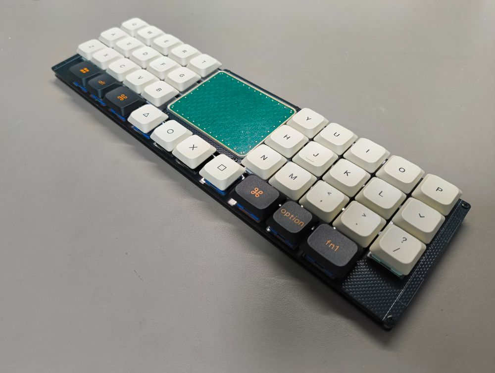
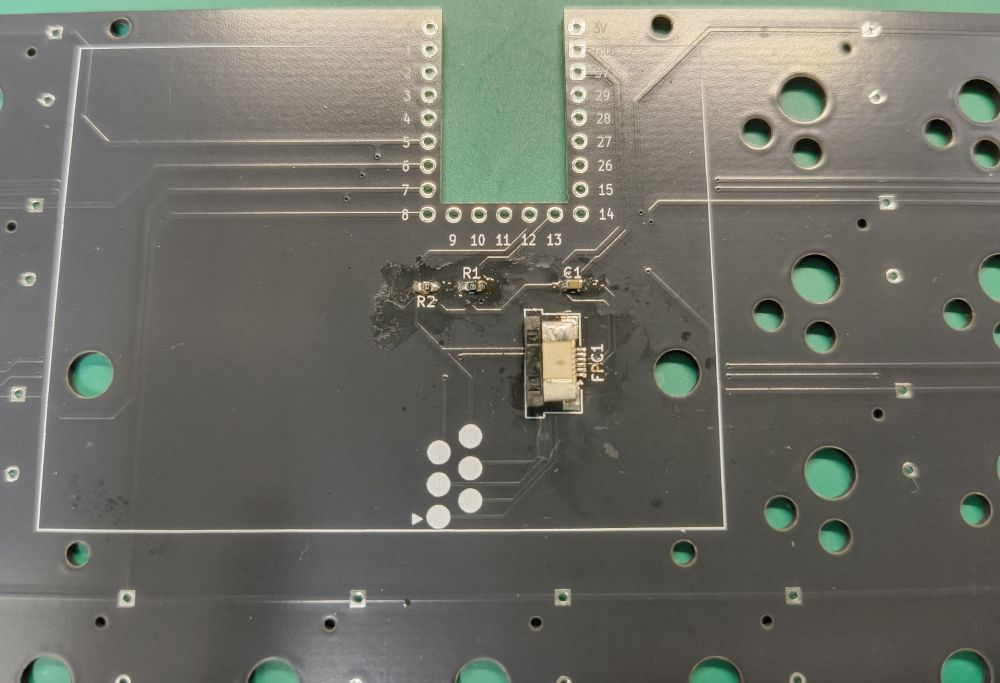
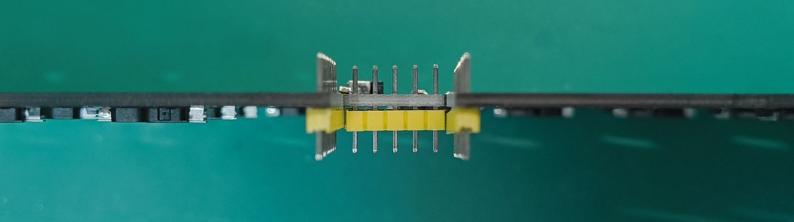
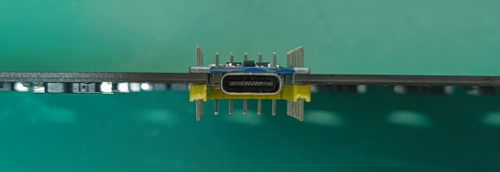
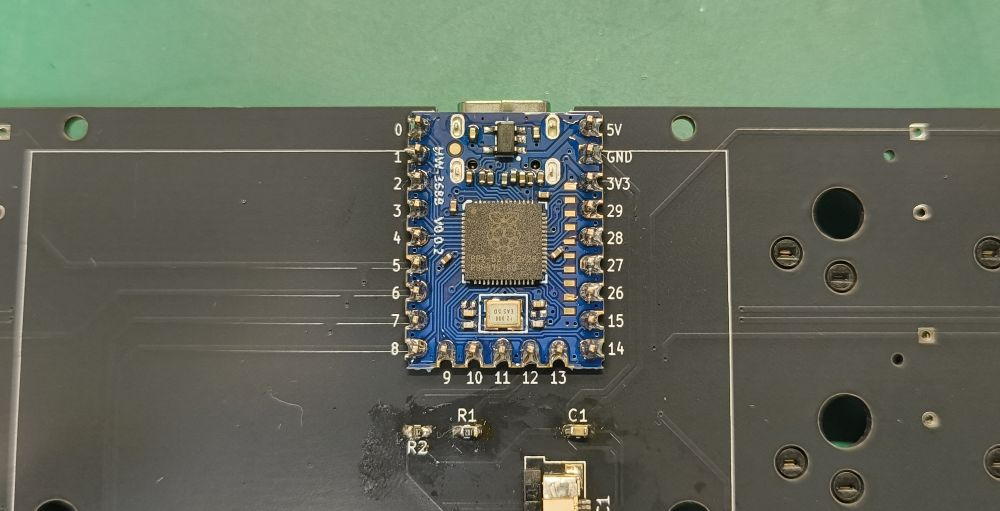
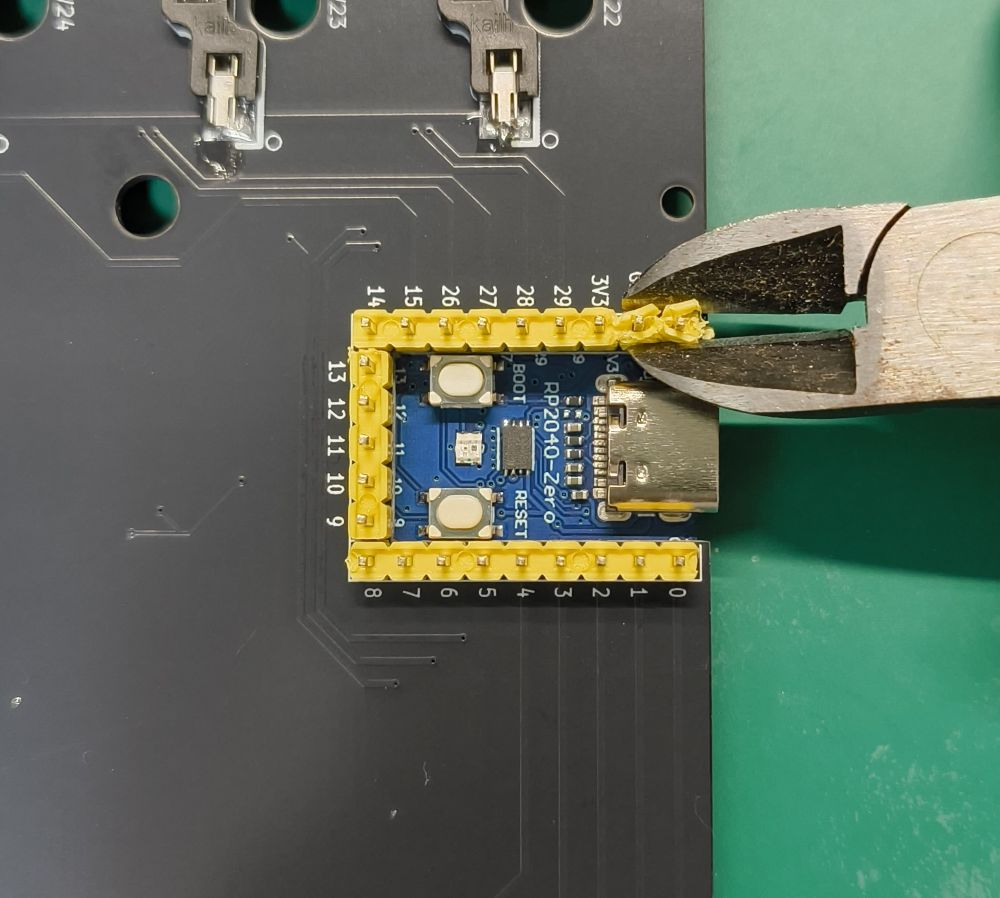
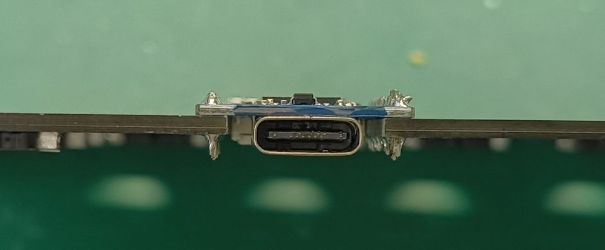
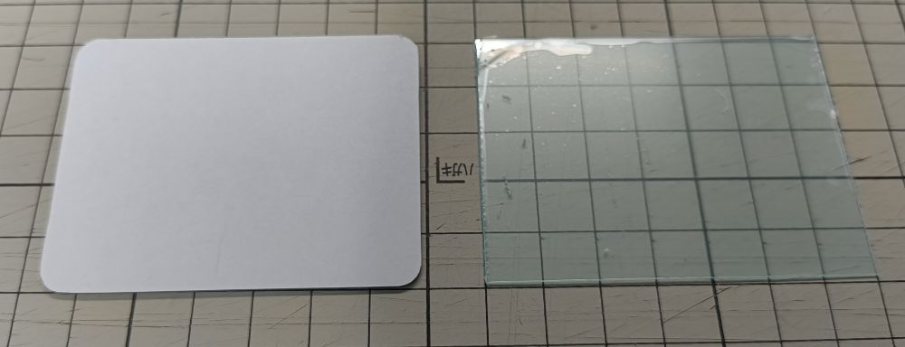
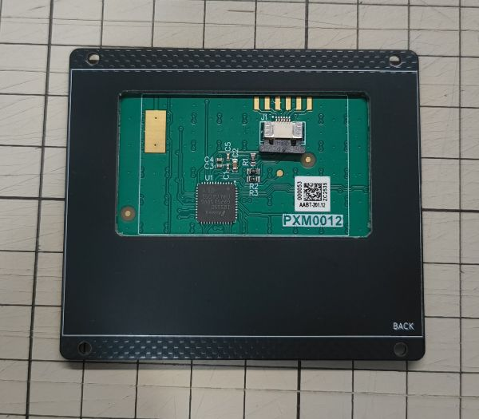
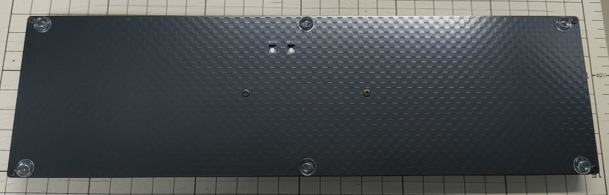

# Girasole40
Girasole40はタッチパッドを中央に配置した、30%オーソリニアレイアウトのロープロファイルコンパクトキーボードです。 
The Girasole40 is the self-maid compact lowprofile keyboard which targets 30% ortholinear layout with a touchpad.

## Parts List

### Parts need to be prepared/purchased

|Part|Quantity|Where I bought it|Remarks|
|---|---|---|---|
|Wired controller board|1|AliExpress|RP2040-Zero (w/ pin headers)|
|USB-C cable|1|-||
|Choc socket|40|yushakobo|e.g. Kailh PG1350 KeySwitches Contact (CPG135001S30)|
|Choc V2 switch|40|AliExpress||
|Keycap|40|Amazon||
|Touchpad Module TPS65 (or clone module)|1|MOUSER|I confirmed [GR-Trackpad65](https://github.com/geek-rabb1t/GR-Trackpad65) works for this keyboard|
|Polycarbonate sheet for touchpad (0.5mm thickness)  or  PVC sheet for touchpad (0.5mm thikness)|1|Amazon|Need to be cut to suit TPS65|
|PET double-sided adhesive sheet|1|Amazon|Need to be cut to suit TPS65|
|M2 Spacer (3.5mm)|4|yushakobo|Spacers for between main plate and touchpad mounting plate|
|M2 Spacer (5.0mm)|6|yushakobo|Spacers for between top plate and bottom plate.|
|M2 screw (3.5mm)|20|yushakobo|-|
|FPC cable (6pin, 0.5mm pitch, 50mm length)|1|Amazon|-|
|Diode|40|MOUSER|1N4148W|
|Resister 1608 1Kohm|2|akizukidenshi|-|
|Capaciter 1608 10uF|1|akizukidenshi|-|
|FPC socket (6pin, 0.5mm pitch)|1|Amazon|-|
|Rubber feet|6|Amazon|-|

### Parts need to be ordered/printed
For the plate stacking configuration

|Part|Quantity|Remarks|
|---|---|---|
|Main PCB|1|<image src="images/plate-main.png" height="100px"> gerber/main.zip|
|Top Plate|1|<image src="images/plate-top.png" height="100px"> gerber/top.zip|
|Bottom plate|1|<image src="images/plate-bottom.png" height="100px"> gerber/bottom.zip|
|Touchpad mounting plate|1|<image src="images/plate-touchpad.png" height="100px"> gerber/touchpad.zip|

### Parts need for gasket mount case

|Part|Quantity|Remarks|
|---|---|---|
|M2 x 8mm|4| |
|1.6mm height M2 nut|4| |
|diameter 4mm, 0.2mm, 5mm spring|2| |

## Build Guide (plate stacking configuration)
### Assemble passive components on the main PCB
Solder a FPC socket, resisters, a capaciter on front side of the main PCB.

Solder diodes and Choc sockets on back side of the main PCB.

Insert pin headers from back side of the main PCB. Then put RP2040-Zero upside down (place USB-C connector down) from front side.

Solder RP2040-Zero from front side.

On back side, remove off the yello parts of the pin header. Then solder RP2040-Zero from back side.

Shorten pin headers by cut them off.

### Assemble the touchpad
Put a double-sided adhesive sheet on the touchpad module.

Put a Polycarbonate or PVC sheet on the adhesive sheet.

Put a double-sided adhesive sheet on the touchpad mounting plate. Then put the touchpad module on it.

### Construct the keyboard
Place the Top Plate on the Main PCB and put Choc V2 keyswitchs.

Put M2 Spacers on both Top Plate and Main PCB.

Connect the Main PCB and the touchpad module using FPC cable.

Fix the touchpad mounting plate and Main PCB.

Fix the Top Plate and the Bottom Plate. Then put rubber feats.

Finally, put keycaps.

## QMK Firmware
### Firmware binary of default layout (no VIA support)
[girasole40_default.uf2](girasole40_default.uf2)