# Girasole40
Girasole40はタッチパッドを中央に配置した、30%オーソリニアレイアウトのロープロファイルコンパクトキーボードです。<br/>
The Girasole40 is the self-maid compact lowprofile keyboard which targets 30% ortholinear layout with a touchpad.

Caseless (PCB sandwich mount)


With case (poron gasket mount)
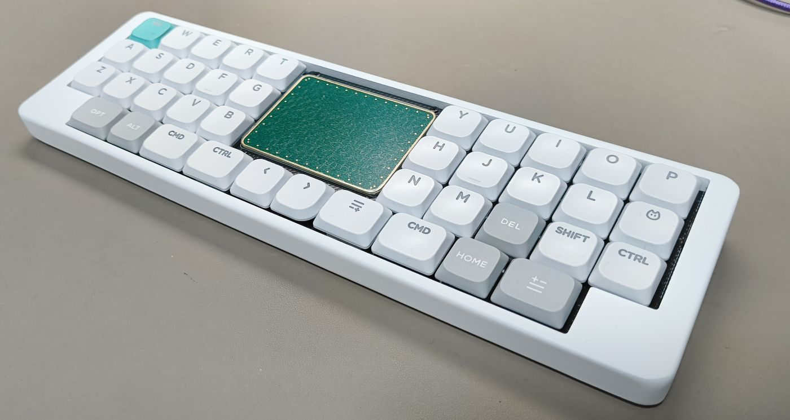

## Parts List

### Parts need to be prepared/purchased

|Part|Quantity|caseless|w/ case|Remarks|
|---|---|---|---|---|
|Wired controller board|1|X|X|RP2040-Zero (w/ pin headers)|
|USB-C cable|1|X|X||
|Choc socket|40|X|X|e.g. Kailh PG1350 KeySwitches Contact (CPG135001S30)|
|Choc V2 switch|40|X|X||
|Keycap|40|X|X||
|Touchpad Module TPS65 (or clone module)|1|X|X|I confirmed [GR-Trackpad65](https://github.com/geek-rabb1t/GR-Trackpad65) works for this keyboard|
|Polycarbonate sheet for touchpad (0.5mm thickness) <br/>or<br/> PVC sheet for touchpad (0.5mm thikness)|1|X|X|Need to be cut to suit TPS65|
|PET double-sided adhesive sheet|1|X|X|Need to be cut to suit TPS65|
|M2 Spacer (3.5mm)|4|X|X|Spacers for between main plate and touchpad mounting plate|
|M2 Spacer (5.0mm)|6|X|X|Spacers for between top plate and bottom plate.|
|M2 screw (3.5mm)|14|X|X|-|
|Additional M2 screw (3.5mm) for caseless|6|X|-|-|
|FPC cable (6pin, 0.5mm pitch, 50mm length)|1|X|X|-|
|Diode|40|X|X|1N4148W|
|Resister 1608 1Kohm|2|X|X|-|
|Capaciter 1608 10uF|1|X|X|-|
|FPC socket (6pin, 0.5mm pitch)|1|X|X|-|
|Rubber feet|6|X|X|-|
|M2 screw (8mm)|4|-|X||
|1.6mm height M2 nut|4|-|X||
|stainless spring (0.4mm wire, d 4mm, L 5mm)|2|-|X||
|poron sheet (L 15mm, W 5mm, d 3mm)|8|-|X||

### Parts need to be ordered/printed
For the plate stacking configuration

|Part|Quantity|caseless|w/ case|Remarks|
|---|---|---|---|---|
|Main PCB|1|X|X|<image src="images/plate-main.png" height="100px"><br/>gerber/main.zip|
|Top Plate|1|X|X|<image src="images/plate-top.png" height="100px"><br/>gerber/top.zip|
|Bottom plate|1|X|-|<image src="images/plate-bottom.png" height="100px"><br/>gerber/bottom.zip|
|Touchpad mounting plate|1|X|X|<image src="images/plate-touchpad.png" height="100px"><br/>gerber/touchpad.zip|
|Top case|1|-|X|<image src="images/case-top.png" height="100px"><br/>case/Girasole40-topcase.step|
|Bottom case|1|-|X|<image src="images/case-bottom.png" height="100px"><br/>case/Girasole40-bottomcase.step|


## Build Guide (Caseless; PCB sandwich mount)
### Assemble passive components on the main PCB
Solder a FPC socket, resisters, a capaciter on front side of the main PCB.


Solder diodes and Choc sockets on back side of the main PCB.

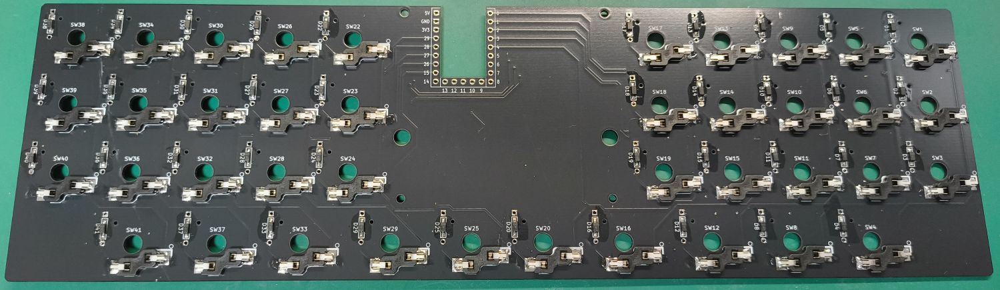

Insert pin headers from back side of the main PCB. Then put RP2040-Zero upside down (place USB-C connector down) from front side.


Solder RP2040-Zero from front side.


On back side, remove off the yello parts of the pin header. Then solder RP2040-Zero from back side.


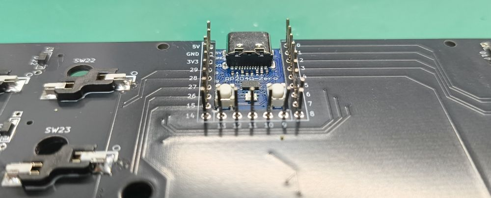

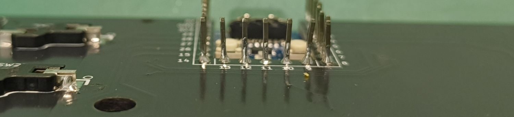

Shorten pin headers by cut them off.


### Assemble the touchpad
Put a double-sided adhesive sheet on the touchpad module.

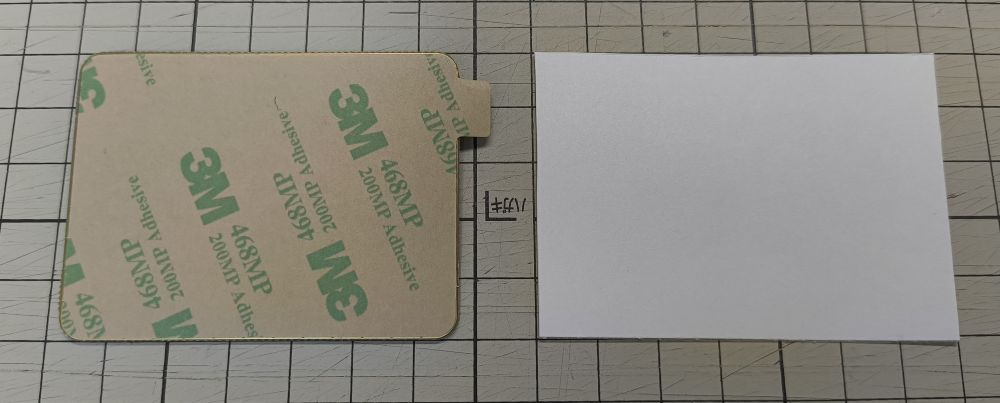

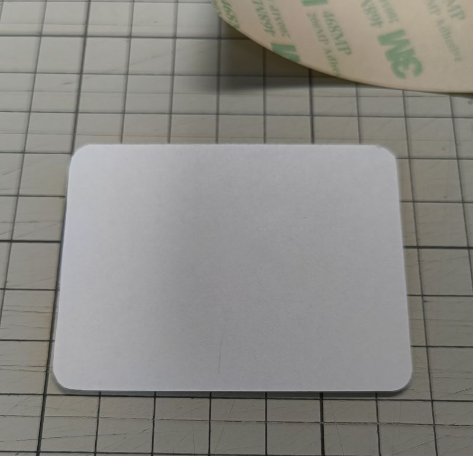

Put a Polycarbonate or PVC sheet on the adhesive sheet.


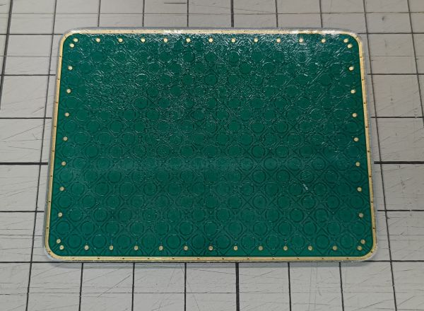

Put a double-sided adhesive sheet on the touchpad mounting plate. Then put the touchpad module on it.

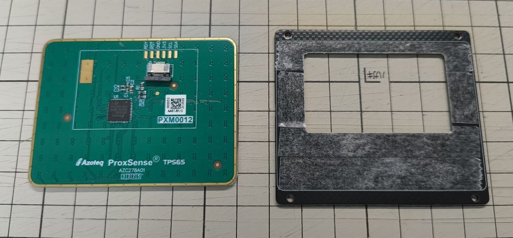


### Construct the keyboard
Place the Top Plate on the Main PCB and put Choc V2 keyswitchs.

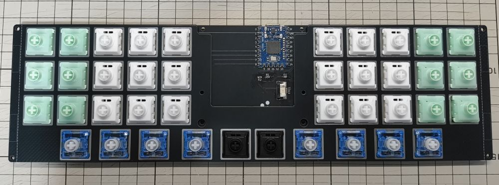

Put M2 Spacers on both Top Plate and Main PCB.

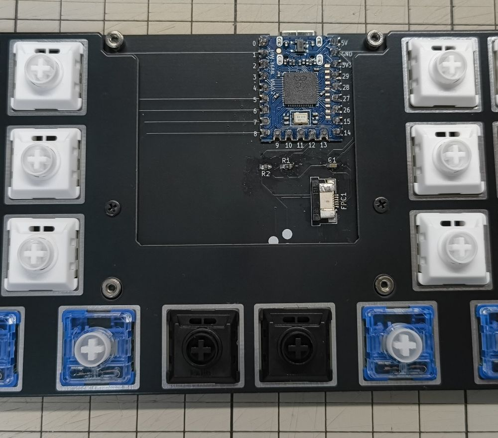

Connect the Main PCB and the touchpad module using FPC cable.

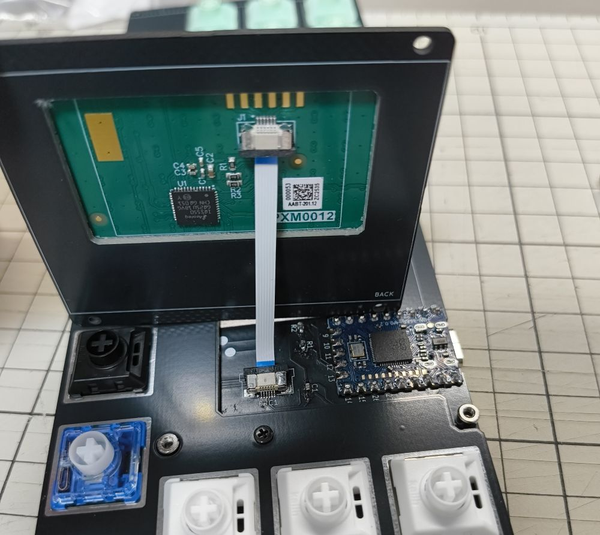

Fix the touchpad mounting plate and Main PCB.

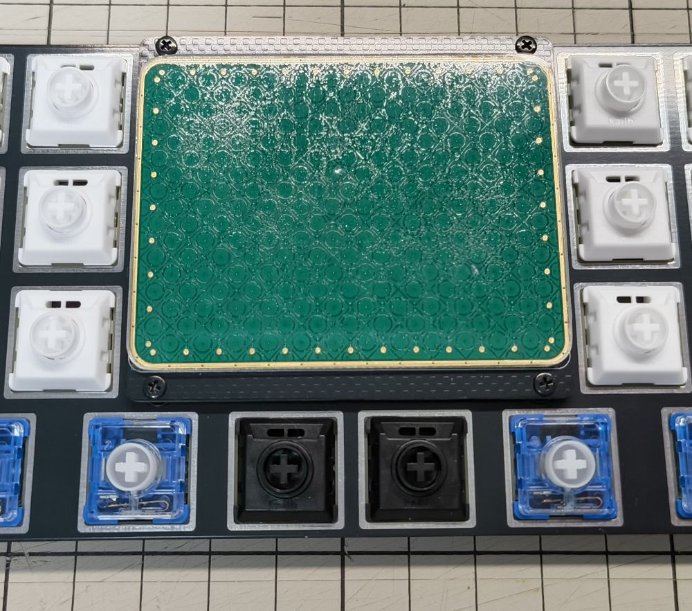

Fix the Top Plate and the Bottom Plate. Then put rubber feats.

Note) If you want to build "with case" configuration, please skip this step.


Finally, put keycaps.

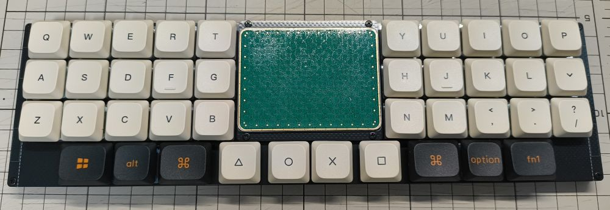


## Build Guide (with case)
Please build the keyboard follows "Build Guide (Caseless; PCB sandwich mount)" towards fix the touchpad mounting plate and Main PCB.

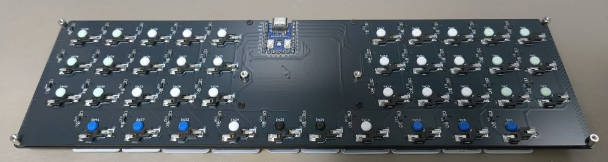

Put the spring into the holes on center of the bottom case.

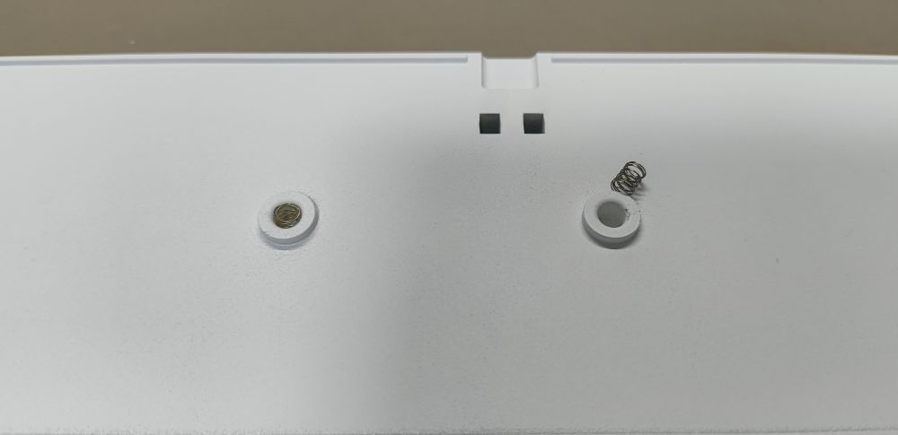

Put the M2 nut into the slots on left & right side of the bottom case.

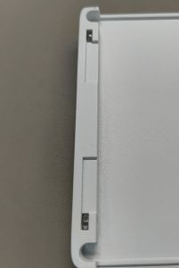
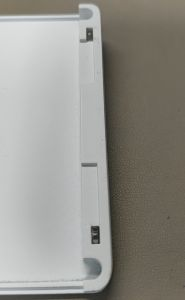

Put the poron sheet onto the grooves on left & right side of the top & bottom case.

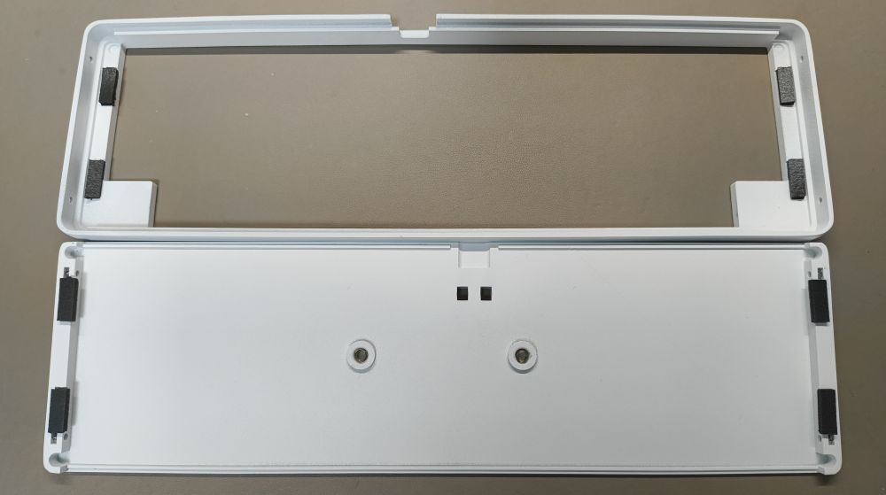

Put the keyboard plate on the bottom case, then put the top case on it.

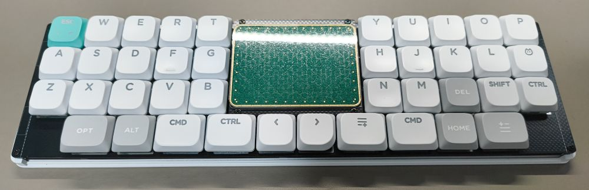

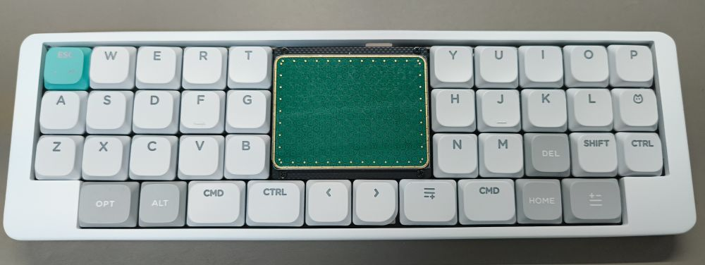

Fix the top & bottom case by screw holes on left & right side using M2 screw (8mm).

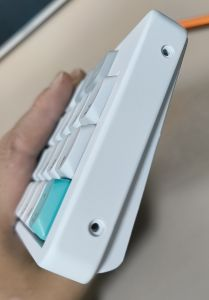

## QMK Firmware
### Firmware binary of default layout (no Vial support)
[girasole40_default.uf2](girasole40_default.uf2)

### Vial support

[girasole40_vial.uf2](girasole40_vial.uf2)

Build the Vial-enabled firmware from a Vial-QMK checkout containing the
`qmk_firmware/keyboards/girasole40` directory:

```text
make girasole40:vial
```

Flash `girasole40_vial.uf2`, then open the keyboard in the Vial desktop app.
The keyboard definition is embedded in the firmware, so no JSON import is
required. `layout/girasole40_vial.json` is retained as a readable copy of that
definition.

The Vial keymap keeps the default eight layers and touchpad controls. The
Combo tab provides 16 editable entries; clearing EEPROM restores the seven
original combos as defaults. The custom keycode section exposes drag-scroll
mode and the CPI up/down keys.

Touchpad gestures include tap followed by a second tap-and-hold for dragging,
and a three-finger tap for middle click. The IQS5xx I2C bus runs at 100 kHz for
stable communication.

When Vial asks to unlock the keyboard, hold the top-left and top-right keys
(Q and P in the default base layer). Clear EEPROM once after replacing an
older dynamic-keymap firmware so the Vial keymap and default combos are initialized.
